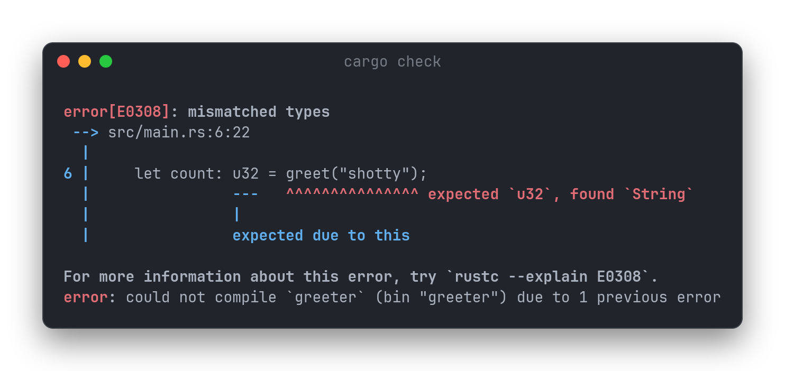

<div align="center">

[](https://github.com/phranck/shotty/releases)
[](https://github.com/phranck/shotty/actions/workflows/ci.yml)
[](https://layered.mit-license.org)
[](https://github.com/phranck/shotty/commits/main)
[](https://github.com/phranck/shotty)
[](https://github.com/phranck/shotty)



</div>

# shotty

shotty turns the output of a command into a PNG or JPG that looks like a terminal window. It keeps the colors, bold and italic text, underlines and wide characters of the original output. It runs on macOS and Linux.

## Install

```bash
brew install phranck/tap/shotty
```

This also installs the man pages and the shell completions for bash, zsh and fish.

## Usage

Pipe any output into shotty. It writes the image and prints its path.

```bash
ls -la --color=always | shotty -o listing.png
git diff --color=always | shotty --theme dracula --title "git diff"
cargo build 2>&1 | shotty -o build.jpg --no-window
```

Many programs switch their colors off when they write into a pipe. Ask them for color, usually with `--color=always`, or let shotty run the command in a terminal of its own:

```bash
shotty --execute "git status" --clipboard
```

Without `-o`, the image is called `shotty-<date>-<time>.png` and lands in the current directory. The file extension decides between PNG and JPG.

## Options

| Option | What it does |
|--------|--------------|
| `-o, --output <PATH>` | Where the image goes |
| `-f, --format <png\|jpg>` | Image format, when the file extension should not decide |
| `-t, --theme <THEME>` | Color theme, `one-dark` by default |
| `-e, --execute <COMMAND>` | Run a command in a terminal and render its output |
| `--columns <COUNT>` | Terminal width; long lines wrap there |
| `-c, --clipboard` | Also copy the image to the clipboard |
| `--title <TEXT>` | Text in the title bar |
| `--no-window`, `--no-shadow` | Leave out the window frame or its shadow |
| `--background <COLOR>` | Color around the window, `transparent` or `#rrggbb` |
| `--font <FAMILY>`, `--font-size <POINTS>` | Font and size, the terminal's by default; `--font bundled` picks the bundled JetBrains Mono |
| `--line-height`, `--padding`, `--scale` | Spacing and resolution |

shotty uses the font and font size of the terminal it runs in, so the picture looks like that terminal. It reads them from iTerm2 and Terminal.app. In other terminals, or when the terminal's font is not installed, it uses the bundled JetBrains Mono at 14 points.

`shotty --help` and `man shotty` describe every option with its default and list the bundled themes.

## Configuration

Defaults go into `~/.config/shotty/config.toml`, or into `$XDG_CONFIG_HOME/shotty/config.toml` when that variable is set. The keys are the long option names. Options on the command line win over the file.

```toml
theme = "nord"
font-size = 16
window = false
background = "#1e1e2e"
```

## Update and uninstall

```bash
shotty update
shotty uninstall
```

`update` fetches the newest release through Homebrew. `uninstall` removes shotty with its man pages, completions, Homebrew download cache and configuration. It asks first unless you pass `--yes`.

## Credits

shotty bundles [JetBrains Mono](https://github.com/JetBrains/JetBrainsMono) under the SIL Open Font License. Its themes come from [iTerm2-Color-Schemes](https://github.com/mbadolato/iTerm2-Color-Schemes) under the MIT license.

## License

This repository has been published under the [MIT](https://layered.mit-license.org) license.
